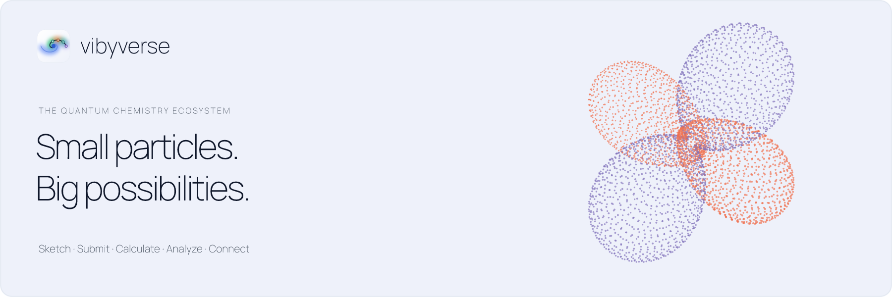

### The ecosystem for computational chemistry

Independent tools for drawing structures, running calculations, exploring results, and sharing scientific data.

**[Explore vibyverse](https://vibyverse.com/)** · **[Developer hub](https://vibe-qc.com/documentation/)** · **[Research & publications](https://vibyverse.com/research/)**

### Five projects, one shared curiosity

| | Project | Start here |
| :--- | :--- | :--- |
| **01 · Sketch** | **[vibe-sketch](https://vibe-qc.com/products/vibe-sketch/)** | Draw chemical structures, reactions, publication graphics and calculation inputs. |
| **02 · Submit** | **[vibe-queue](https://github.com/vibyverse/vibe-queue)** | Submit and track jobs across configured local, remote and cluster resources. |
| **03 · Calculate** | **[vibe-qc](https://github.com/vibyverse/vibe-qc)** | Explore electronic structure for molecules and periodic solids. |
| **04 · Analyze** | **[vibe-view](https://github.com/vibyverse/vibe-view)** | Inspect structures, orbitals, densities and spectra. |
| **+ · Connect** | **[QVF](https://github.com/vibyverse/qvf)** | Preserve scientific data and provenance in an independent, shareable archive format. |

### Science with context

Developed through AI-assisted engineering under the scientific direction of Dr. Michael F. Peintinger. Consult each project's documentation for supported methods, limitations and validation evidence, and cite the software version and methods used in your research.

QVF remains producer-neutral; its reference toolkit is Apache-2.0 licensed. Each project retains its own license and release cycle.

### Join the work

Start with a project's README and contribution guide. Bring a reproducible bug report, an example, documentation improvements, or scientific expertise. For sensitive reports, follow the repository's security policy.

Interested in collaboration, sponsorship or contributing computing resources? **[Get in touch](mailto:project@vibe-qc.com)**.

[News & stories](https://vibyverse.com/journal/) · [Research](https://vibyverse.com/research/) · [vibyverse.com](https://vibyverse.com/)
